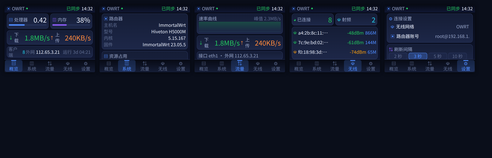
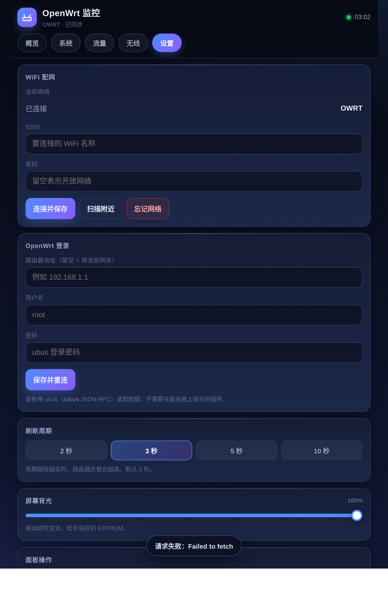

# OpenWrt Monitor · ESP32-2432S028R 路由器监控面板

把一块 **2.8 寸 CYD（ESP32-2432S028R，320×240）** 做成 OpenWrt 状态面板：
五页中文界面 + 内置 WebUI 后台 + **投屏接收**（上位机能把任意画面推到这块屏上）。

原始版本是单页英文 dashboard（负载 / 内存 / 速率 + 配网页）。这一版在它的基础上：

- 升到 **LVGL 9.6.0**（重写了显示/输入设备驱动与整个设计系统）
- 界面**全中文化**，配套一套可复现的**字体子集**流程
- 轮询改成非阻塞分步状态机
- 加了完整网页后台，以及兼容 `esp32-wifi-screen` 的**投屏接收协议**



> 上排：概览 · 系统 · 流量　｜　下排：无线 · 设置。
> 按 `ui_theme.h` 里的令牌和字体的真实行高（`ui_font_cn_16` line_height=21、
> `ui_font_cn_24` line_height=29）在 Chromium 里 1:1 排出来核对过，无溢出。
> 英文版的旧界面见 `preview_en.png`。

---

## 1. 这一版改了什么

| 项目 | 原版 | 现在 |
|---|---|---|
| LVGL | 8.3.x | **9.6.0**（`lv_display_t` / `lv_indev_t` / 新 label 长模式 / 手动挂 tick） |
| 界面 | 1 个页面，挤在 320×240 里 | **5 个中文页面** + 顶部状态栏 + 底部图标导航 |
| 字体 | LVGL 内置 Montserrat，界面全英文 | **思源黑体子集**（GB2312 一级字 3755 个 + 标点 + UI 用字），界面全中文 |
| 图标 | LVGL 内置符号 | 17 个自绘 24×24 A8 单色位图，运行时 recolor（`ui_icons.h`） |
| 视觉 | 纯色块 + 分隔线 | 深色玻璃拟态：渐变底、渐变卡片、1px 描边、蓝紫强调色、胶囊标签 |
| ubus 轮询 | 一轮连发 4~5 个同步请求，最长卡 10 秒以上 | **每次 loop 只发一个请求**的分步状态机，界面与网页全程可用 |
| 网页后台 | 无 | `/`（状态页）、`/api/state`、`/api` 命令、SSE 实时推送、PWA 可加到主屏幕 |
| **投屏** | 无 | HTTP + WebSocket 收帧，支持 JPEG / RGB565 / LZ4，**流式解码不上整帧缓冲** |
| 背光 | 只能常亮 | PWM 调光（屏幕滑条 / 网页滑条 / WS 命令，掉电保存） |
| 参数 | 改代码重烧 | WiFi、路由器账号、刷新周期、背光都能在屏幕或网页上改 |

---

## 2. 硬件

| 项 | 说明 |
|---|---|
| 主控 | ESP32-WROOM-32（4MB Flash，**无 PSRAM**） |
| 屏幕 | ILI9341 320×240 SPI，横屏（`setRotation(1)`） |
| 触摸 | XPT2046 电阻触摸，与屏共用 SPI |
| 背光 | GPIO21（LEDC 20kHz PWM 调光） |

SPI 引脚（CYD 标准接法，`TFT_eSPI` 的 `User_Setup` 里要一致）：

```
MOSI 13   MISO 12   SCLK 14   CS 15   DC 2   RST -1（接复位）   BL 21
触摸：CS 33  CLK 25  DIN 32  DOUT 39
```

> **无 PSRAM 是本项目所有内存取舍的前提**：整帧画面是 153,600 字节，
> 投屏代码因此全程流式处理，详细见第 7 节。

---

## 3. 编译

### 3.1 Arduino IDE

1. **开发板**：`ESP32 Dev Module`
2. **分区方案**：`Huge APP (3MB No OTA / 1MB SPIFFS)` —— 网页 + 图标 + 字体都在 app 里
3. **库**：
   - `lvgl` **9.6.x**（**不是 8.x**：本工程用的是 `lv_display_*` / `lv_image_dsc_t` / `lv_screen_load` 这套 API）
   - `TFT_eSPI`
   - `TFT_Touch`
   - `ArduinoJson`（6.x 或 7.x 都行，代码里用宏做了兼容）
   - `TJpg_Decoder`（可选，只影响 `:81/draw_image` 推 JPEG）
4. **`lv_conf.h`**：把本目录的 `lv_conf.h` 放到 `<Arduino>/libraries/` 下（**与 lvgl 文件夹同级**）。
   关键点已经配好了，改动前注意这几项：
   ```c
   #define LV_COLOR_FORMAT_DEFAULT LV_COLOR_FORMAT_RGB565   /* v9 用它取代 LV_COLOR_DEPTH */
   #define LV_USE_FONT_COMPRESSED  0                        /* 子集字体本身就没压缩 */
   #define LV_FONT_MONTSERRAT_*    0                        /* 内置字体全部关掉，省 flash */
   #define LV_USE_CUSTOM_FONT_DEFAULT  1
   #define LV_FONT_USE_CUSTOM_INCLUDE  1
   #define LV_FONT_CUSTOM_INCLUDE  "ui_fonts.h"             /* 中文默认字体在这里挂进去 */
   ```
   v9 已经没有 `LV_TICK_CUSTOM`，时钟在 `setup()` 里显式挂：`lv_tick_set_cb(millis)`。
5. **`TFT_eSPI` 的 `User_Setup.h`** 按上面的引脚改好（CYD 需要 `ILI9341_2_DRIVER`）。
6. 打开 `OpenWrtMonitor.ino`，直接上传。

### 3.2 PlatformIO

给了 `platformio.ini`，引脚已经在 `build_flags` 里定义好，不用改 `User_Setup.h`。
`TFT_Touch` 不在 PlatformIO 注册表里，clone 到工程的 `lib/` 下即可：

```bash
git clone <你的 TFT_Touch 仓库> lib/TFT_Touch
pio run -t upload
pio device monitor
```

---

## 4. 第一次使用

1. 上电，屏幕先出「配网」页，自动扫描附近 WiFi；
2. 点一个 SSID → 输入密码 →「连接」（凭据存 EEPROM，下次开机自动连）；
3. 连上后回到概览页，顶部状态栏出现 SSID 与「已同步」；
4. 进「设置」页 → 路由器登录，填路由器 IP（留空 = 用 DHCP 网关）、用户名、密码；
5. 保存后自动重新登录 ubus，数据开始刷新。

> 配网密码用的是 LVGL 的软键盘，特殊键（`确定`/`关闭`/`退格`/`换行`/`左移`/`右移`、
> 密码遮罩点）已经换成中文 —— 没有 PSRAM 也塞不下 FontAwesome 符号字体，
> 所以直接把 `LV_SYMBOL_*` 宏重定义成中文：LVGL 内部是拿字符串做 `lv_strcmp` 判键的，
> 显示和行为共用同一个宏，改掉即可两边都对得上。

> 路由器侧**不需要装任何插件**，用的都是 OpenWrt 自带的 ubus 对象：
> `system.board`、`system.info`、`network.interface`、`network.device`、`iwinfo.assoclist`。
> 前提是路由器开了 `uhttpd` 的 `/ubus` 接口（默认开）且该账号有 ubus ACL 权限（root 一定有）。

---

## 5. 屏幕上的五个页面

| 页 | 内容 |
|---|---|
| **概览** | 处理器负载 + 内存占用（大字 + 进度条）、实时下载/上传、客户端数、外网 IP、运行时长 |
| **系统** | 主机名 / 型号 / 内核 / 固件版本、1·5·15 分钟负载、内存与交换分区、面板自身（空闲内存、WiFi 信号、面板地址、已运行） |
| **流量** | 40 点实时曲线（上/下双线，Y 轴自适应）、当前速率与峰值、接口名、WAN IP、协议、累计收发 |
| **无线** | 关联客户端数、射频数、客户端列表（MAC / 信号 / 协商速率，信号强弱用颜色区分） |
| **设置** | WiFi 配网入口、路由器登录入口、刷新间隔（2/3/5/10 秒）、背光、网页后台地址、重启面板 |

底部导航：图标 + 两个汉字，选中项高亮并带顶部小横条。

---

## 6. WebUI 后台

板子自己就是 Web 服务器：

| 访问方式 | 地址 |
|---|---|
| 局域网 | `http://<板子IP>`（屏幕设置页能看到） |
| mDNS | `http://openwrt-monitor.local`（iOS 一般可用，安卓看浏览器） |

页面结构与屏幕一一对应（概览 / 系统 / 流量 / 无线 / 设置），另外多做了：

- **SSE 实时推送**：屏幕或网页任一侧改了参数，另一侧立刻跟着变；
- **点网页页签，屏幕同步切页**（`{"c":"ui","id":n}`）；
- 网页上能改 WiFi（带扫描列表）、路由器账号、刷新周期、背光；
- 流量图画在 `<canvas>` 上（60 点本地历史），比屏幕上更细；
- 带 PWA 清单，手机可「添加到主屏幕」，全屏无地址栏。



### 6.1 为什么 SSE / 投屏都在 81 端口

ESP32 的 `WebServer` 不支持长连接：回完响应就 `Connection: close`，而且会声明
`Transfer-Encoding: chunked`。更要命的是它会把整个 POST body 收进一个 `String` ——
153KB 的投屏整帧能把堆直接吃穿。

所以 81 端口单独开一个**裸 socket 服务**，自己写 HTTP 头；这一个端口伺候三拨人：
`GET /events`（SSE 长连接）、投屏 HTTP 接口、`GET /ws`（WebSocket 升级）。
读请求头时逐字节比对 `\r\n\r\n` 立刻收手，不会把 body 一起吞掉。

浏览器侧用 `EventSource('http://<ip>:81/events')`，跨端口靠 `Access-Control-Allow-Origin: *`。
SSE 连不上时会自动退回 5 秒轮询，不会白屏。

### 6.2 HTTP API（80 端口）

| 方法 | 路径 | 说明 |
|---|---|---|
| GET | `/` | 控制台页面（内嵌 flash，约 22KB，分块推送，不进堆） |
| GET | `/manifest.json` / `/icon.svg` | PWA 清单与图标 |
| GET | `/api/state` | 状态快照 JSON |
| POST | `/api` | 控制命令 |
| GET | `:81/events` | SSE 事件流 |

`POST /api` 的命令：

```jsonc
{"c":"wifi",   "ssid":"<你的 WiFi 名>", "pass":"<WiFi 密码>"}   // 保存并连接
{"c":"router", "ip":"192.168.1.1", "user":"root", "pass":"<路由器密码>"}
{"c":"poll",   "ms":3000}                           // 2000~10000
{"c":"bright", "pct":80}                            // 10~100
{"c":"ui",     "id":2}                              // 让屏幕切到第 3 页
{"c":"scan"}                                        // 扫附近 WiFi（结果在 state.ap）
{"c":"forget"}                                      // 清除 WiFi 并进配网
{"c":"reboot"}
```

---

## 7. 投屏接收（把任意画面推到这块屏上）

**协议逐字节兼容 [`planet0104/esp32-wifi-screen`](https://github.com/planet0104/esp32-wifi-screen)**
（MIT）。它家的上位机不用改就能推过来；你也可以自己写，比如「主机渲染 HTML →
截图 → JPEG → 推下来」，这样自定义 UI 想怎么画就怎么画。

### 7.1 接口

| 方法 | 路径 | 说明 |
|---|---|---|
| GET | `:81/display_config` | `{"width":320,"height":240,"rotated_width":320,"rotated_height":240,"rotation":90,"protocol":"esp32-wifi-screen"}` |
| POST | `:81/draw_image` | body = JPEG 文件（需要 `TJpg_Decoder`） |
| POST | `:81/draw_rgb565` | body = 整帧 RGB565，**每像素 2 字节、高字节在前**；尺寸可用 `?width=&height=` 指定，缺省 320×240 |
| POST | `:81/draw_rgb565_lz4` | body = `[u32 LE 解压后长度] + LZ4 块` |
| GET | `:81/ws` | WebSocket 二进制帧（见下），服务端回 `ACK` / `NACK` 文本帧 |
| GET | `:81/cast_exit` | 退出投屏，回到监控界面（屏上点一下也一样） |

WebSocket 二进制帧的格式：

```
JPEG 文件                                           直接用
"RGB565" + 整帧像素                                  6 字节前缀 + 像素
"wflz4ke_" + u16BE width + u16BE height + LZ4 数据   关键帧
"wflz4dl_" + 同上                                    差分帧 —— 本机不支持，回 NACK
"wflz4no_"                                          无变化帧，直接回 ACK
```

服务端回 `ACK` / `NACK`：收到 `NACK` 的上位机会重置差分编码器，下一帧改发关键帧。
WS 文本帧是命令通道：`{"cmd":"exit"}` 退出投屏，`{"cmd":"brightness","value":70}` 调背光。

握手的 `Sec-WebSocket-Accept` 是固件里手算的（内置一份 SHA-1 + Base64，
不依赖 mbedtls 配置），已用 Python `hashlib` 交叉验证过，含 RFC 6455 官方样例
`s3pPLMBiTxaQ9kYGzzhZRbK+xOo=` 全对。

### 7.2 为什么这么做（无 PSRAM 的取舍）

| 内存 | 大小 | 结论 |
|---|---|---|
| 整帧像素 | 320×240×2 = 153,600B | **不申请**。LZ4 边解边攒行，`setAddrWindow + pushColors` 推出去 |
| LZ4 回看窗口 | 64KB 环形 | 必需（LZ4 匹配偏移最大 65535），会话期间申请，退出释放 |
| 差分参考帧 | 153,600B | **放弃**。差分还要再多吃一份同样大的解压缓冲，顶不住 |

所以：

- **支持** 关键帧 / 无变化帧 / 裸 RGB565 / LZ4 / JPEG；
- **不支持** 差分帧，收到就回 `NACK` —— 上位机会自动退化成「每帧都发关键帧」。
  320×240 的关键帧压缩后通常 2~40KB，本地网足够跑几帧每秒；
- 尺寸不匹配的帧会**居中处理**：比屏幕大就裁剪，比屏幕小就留黑边；
- 投屏期间 LVGL 完全松手（`loop()` 里不跑 `lv_timer_handler`、不跑 ubus 轮询），
  画面谁都没法盖上去；6 秒收不到帧或屏幕上点一下就退回监控界面，
  退出时会逼 LVGL 整屏重绘一次（`lv_obj_invalidate` + `lv_refr_now`）。

### 7.3 自己写上位机的最小例子（Python）

```python
import socket, struct, lz4.block

ip = "192.168.1.23"
rgb565 = b"..."                                   # 320*240*2 字节，高字节在前
pay = struct.pack(">HH", 320, 240) + lz4.block.compress(rgb565, store_size=False)

s = socket.create_connection((ip, 81))
s.sendall(b"POST /draw_rgb565_lz4 HTTP/1.1\r\nHost: %s\r\n"
          b"Content-Length: %d\r\nConnection: close\r\n\r\n"
          b"%s%s" % (ip.encode(), len(pay) + 4, struct.pack("<I", len(rgb565)), pay))
print(s.recv(4096))                               # -> HTTP/1.1 200 OK ... OK 82ms
```

Python 的 `lz4.block.compress(..., store_size=False)` 正好就是
`lz4_flex::compress_prepend_size` 去掉那 4 字节前缀的产物，
和本项目的 `[u32 LE 长度] + LZ4 块` 完全对得上。

---

## 8. 中文与字体子集

界面用到两个字库，都是思源黑体（`Noto Sans CJK SC`）子集化的产物：

| 字体 | 字形数 | .c 文本 | 实际进 flash |
|---|---|---|---|
| `ui_font_cn_16` | 3995 | 2.8MB | **≈331KB**（4bpp 抗锯齿，约 85B/字） |
| `ui_font_cn_24` | 238 | 310KB | **≈23KB**（只含数字、单位、少量 UI 用字） |

> `.c` 文件看着有 3MB，别被吓到：那是因为每个字形都写成了一长串十六进制字面量，
> 编进固件只占 **≈354KB**，连同网页（22KB）+ 图标（69KB）一起，3MB app 分区绰绰有余。

字符集来源：

- `cn_full.txt`：GB2312 **一级汉字 3755 个**（覆盖了绝大多数界面用字）+ 中文标点 + 补充字；
- `cn_small.txt`：ASCII、数字、单位与少量 UI 用字，给 24px 那个大字库用。

改完界面文案，**务必跑一遍校字**，否则屏幕上就是一格漏字方框（编译、烧录都看不出来）：

```bash
python3 tools/check_font.py            # 校验 UI 文案用到的字是否都在字库里
python3 tools/check_font.py --all      # 连注释里的中文一起算，方便提前补字
```

漏了字就把缺的字符追加到 `cn_full.txt`，重跑 `tools/gen_fonts.sh` 生成。

排版依赖的行高是从生成的字体结构体里量出来的：
`ui_font_cn_16` → `line_height=21, base_line=5`，`ui_font_cn_24` → `line_height=29, base_line=7`。
`ui_theme.h` 里的 `UI_LH_16 / UI_LH_24` 就是这两个值，所有卡片高度都按它算 ——
中文字体的行高比同号的拉丁字体大不少，这也是「英文版放得下的两行、中文版放不下」
需要重排版的根本原因。

---

## 9. 实现要点（改代码前值得看一眼）

**轮询是状态机，不是一个函数。** `pollBeginCycle()` 把 `pollStep` 置到 `PS_LOGIN`，
之后**每次 `loop()` 只前进一步**（登录 → board → info → interface → device → 每个射频的
assoclist），中间照常跑 `lv_timer_handler()` 和 `server.handleClient()`。

**无线列表按指纹重建。** `clientsHash()` 把 MAC/信号算成 32 位指纹，只有变了才
`lv_obj_clean()` 重建控件，否则每 3 秒刷新会让列表闪一下。

**标签写值前先比较。** `ui_set_text()` 内容相同就直接返回，避免无意义的重绘。

**配色和尺寸集中在 `ui_theme.h`。** 改主题只动一个文件；
`UI_STATUS_H(28) + UI_CONTENT_H(166) + UI_NAV_H(46) = 240`，
改任何一段都要重算另外两段。

**图标是 A8 位图。** 24×24、每像素 1 字节透明度，全在 flash，
换色靠 `lv_obj_set_style_image_recolor()`（v9 的 API 名，v8 叫 `img_recolor`）。

**投屏是流式解码。** LZ4 解码器是手写的（`castLz4()`），
为的就是不落地 153KB 整帧。这段容易写错而编译器又查不出来，
`tools/test_lz4.py` 会在主机上把它切出来跑 round-trip：全字面量、超长重叠匹配、
跨 64KB 窗口回绕、非整帧长度，一共 6 个用例。

---

## 10. 排障

| 现象 | 原因 / 处理 |
|---|---|
| 屏幕白屏、串口有输出 | `TFT_eSPI` 的 `User_Setup.h` 引脚不对，或背光没使能（GPIO21） |
| 编译报一堆 `lv_disp_drv_t`/`lv_img_dsc_t` 未定义 | 装的还是 LVGL 8.x，换成 **9.6.x** |
| 界面中方块 / 缺字 | 字库里没有这个字：`python3 tools/check_font.py` 查一下，补字重生成 |
| 触摸点偏 | `setup()` 里的 `touch.setCal(526, 3443, 750, 3377, 320, 240, 1)` 是这块板的典型值；偏差大就重新标定 |
| 网页打不开，屏幕正常 | 板子 IP 变了；看设置页的 URL。或手机和板子不在同一网段 |
| 网页有数据但一直是「等待数据」 | ubus 登录失败：串口会打 `[ubus] login rejected rc=...`，检查账号密码 / `/ubus` 是否可达 |
| 速率一直是 0 | 上行口没选对：串口打 `iface=xxx`，如果是 `br-lan` 说明路由器 WAN 走的是桥，可在 `fetchDevices()` 里调整优先级 |
| 投屏推不进去 | 先看 `GET :81/display_config` 通不通；JPEG 要装 `TJpg_Decoder`；差分帧会被回 `NACK`（故意的，见 7.2） |
| 投屏几秒就退回界面 | 6 秒没收到帧；注意上位机是否在等 ACK 才发下一帧（本固件就是这么约定的） |
| 重启后配置丢失 | `EEPROM.commit()` 没生效；确认 `EE_MAGIC` 写入成功（串口 `[cfg]` 行） |

---

## 11. 已知限制

- **不支持差分帧**（内存不够，见 7.2），上位机会退化成逐帧关键帧。
- 无线客户端最多显示 16 条（`MAX_CLIENTS`），再多就是屏幕放不下。
- 不支持 WPA3-Enterprise / 802.1x 的 AP。
- 电阻触摸没有多点，滑条要按在滑块附近才好拖。
- 软键盘是 LVGL 自带的 QWERTY 布局（只把特殊键换成了中文），没有中文输入法 ——
  配网密码是连路由器用的，一般不输中文。

---

## 12. 目录

```
OpenWrtMonitor.ino   主固件：数据采集 + 5 页中文界面 + 网页后台 + 配网页 + 投屏接收
ui_theme.h           设计系统（配色 / 圆角 / 间距 / 卡片·按钮·列表行构建器）
ui_fonts.h           LVGL 钩子：把中文字体挂成全局默认 + LV_SYMBOL_* 中文化
ui_font_cn_16.c      中文 16px 子集（3995 字形，≈331KB flash）
ui_font_cn_24.c      中文 24px 子集（238 字形，≈23KB flash，大字 / 数字）
ui_icons.h           17 个 24×24 A8 图标（tools/gen_icons.py 生成，别手改）
webui_html.h         内嵌 WebUI（HTML/CSS/JS 单页，含 PWA 清单与图标）
lv_conf.h            LVGL 9.6 配置（放到 libraries 根目录）
platformio.ini       PlatformIO 工程配置（可选）
tools/gen_icons.py   图标生成脚本（PIL 绘制 → LVGL 9 的 lv_image_dsc_t）
tools/gen_fonts.sh   中文字库流水线（pyftsubset + lv_font_conv）
tools/check_font.py  校字：源码文案里的每个字是否都在字库里
tools/test_lz4.py    主机上跑投屏 LZ4 解码器的 round-trip 测试
preview_cn.png       中文界面排版预览（5 页）
preview_en.png       英文版旧界面
webui-preview.png    网页后台预览

../luci-app-esp32-screen/   配套的 OpenWrt LuCI 插件（APK 包，见 §14）
```

---

## 13. 验证情况

| 项目 | 手段 | 结果 |
|---|---|---|
| 语法 / API 类型 | 拿 **LVGL 9.6.0 真实头文件**跑 `g++ -fsyntax-only`（含 ArduinoJson 7） | **0 error** |
| LVGL 9 迁移点 | `lv_display_*` / `lv_indev_*` / 新 label 长模式 / `lv_image_set_scale` 逐个核对 | 全部改到位 |
| 中文字覆盖 | `tools/check_font.py --all` | 源码里 175 个非 ASCII 字符全部命中，0 漏字 |
| SHA-1 / Base64 | 与 Python `hashlib` 逐用例比对 + RFC 6455 官方握手样例 | 完全一致 |
| LZ4 解码 | `tools/test_lz4.py` 6 个用例 round-trip | 6/6 通过 |
| 中文排版 | Chromium 里按真实行高 1:1 排版，再用 DOM 量一遍溢出 | 横向无溢出，右下无越界 |
| 完整链接 | 沙箱里 xtensa 工具链下载受限 | **未跑**，烧录前请在本地 `pio run` 一次 |

烧录前请本地编译一次；若报 `TFT_Touch` 相关错误，确认库是本项目用的那份
（API：`Pressed/X/Y/setCal`）。

---

## 14. 配套的 LuCI 插件

`../luci-app-esp32-screen/` 是同一套东西的路由器侧界面，**APK 包格式**，
OpenWrt 24.10 / 25.12 主线可用。三个页面：

| 页面 | 说明 |
|---|---|
| 状态 | 面板采集到的路由器数据 + 遥控（切页 / 背光 / 采集周期 / 重启 / 退出投屏） |
| 投屏 | 浏览器里画 320×240（内置概览·流量模板，或自己写 HTML），POST 到 `:81/draw_rgb565` |
| 设置 | 面板地址 / mDNS 名 / 默认模板 / 自定义 HTML / 连续推送间隔 |

设计上**尽量不经过路由器**：浏览器直连面板（固件那边已经开了
`Access-Control-Allow-Origin`），ubus 只用来存配置；浏览器够不着面板时
才降级到 `ubus call luci.esp32-screen probe`，由路由器代问一次。

```sh
ubus call luci.esp32-screen get
ubus call luci.esp32-screen set '{"values":{"host":"192.168.1.23"}}'
ubus call luci.esp32-screen probe
```

四个 JS 文件 `node --check` 全部通过，ucode 后端有 `tools/test_ucode.py`
（19 项，全通过）。详见该目录下的 README。
